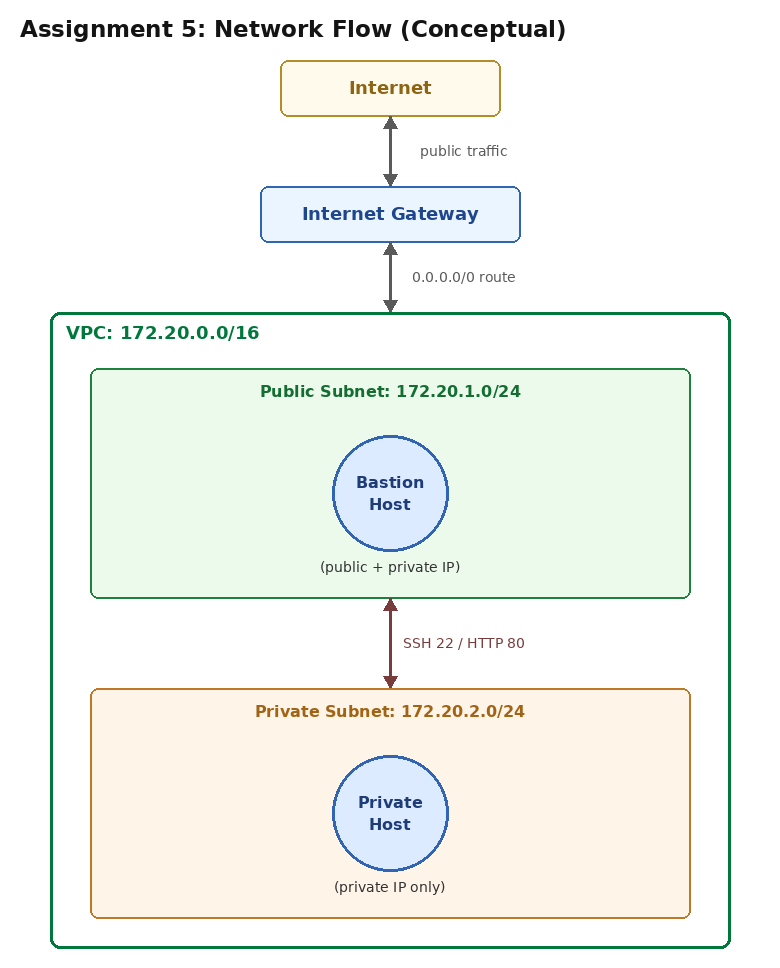
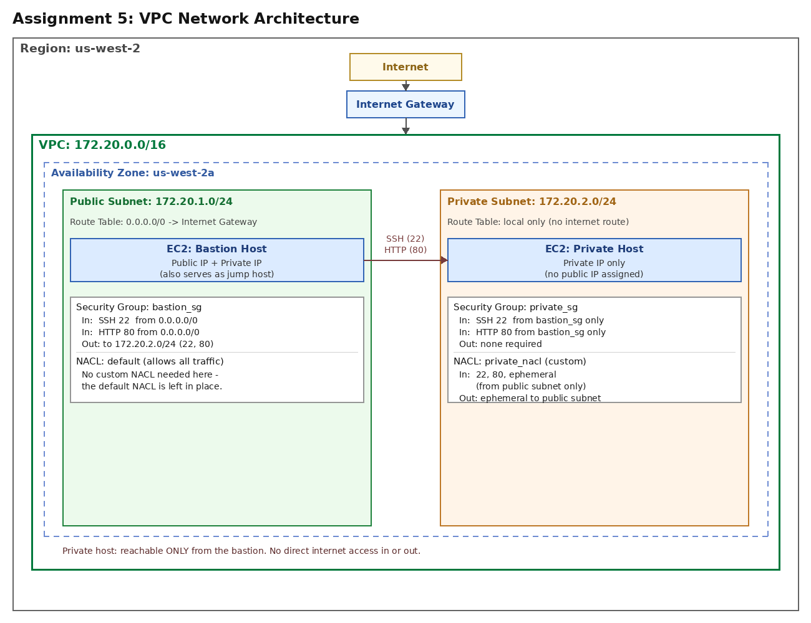

# Assignment 5: VPC Networking with Terraform

## Objective

{width=50%}

This assignment puts Module 5's networking concepts into practice. You will use Terraform to build a VPC with one public subnet and one private subnet, launch an EC2 instance in each, and configure Security Groups and Network ACLs so that:

- The **public host** (which also acts as your bastion) is reachable from the internet.
- The **private host** is reachable **only** from the public host — not from the internet at all, in either direction.

There is no NAT Gateway in this assignment. The private host has zero internet access, full stop — that's the isolation model we're building, not a limitation to work around.

**AI Tools:** You may use AI coding assistants to help draft your Terraform configuration. Review any AI-generated code carefully before running it — see the "Agentic AI" slides from Module 5 for what to check, especially around Security Group and NACL scoping. You are responsible for understanding and defending every line you submit.


## Before You Begin: Configure AWS Credentials Locally

If you haven't already configured the AWS CLI locally this semester, follow the "Before You Begin" section from Assignment 4's instructions (`aws configure`, then verify with `aws sts get-caller-identity` and `aws configure get region`) before starting Part 1.

## What's Provided

Your repository comes with the following, already complete:

- **`app/server.py`** — a healthcheck service that reports which host answered it, plus a `/check-private` proxy endpoint the bastion uses so Gradescope can verify bastion→private connectivity over plain HTTP. It uses only the Python standard library — **no `pip install` required**, which matters because the private host has no internet access to reach PyPI. Do not modify this file.
- **`terraform/versions.tf`** — Terraform and AWS provider configuration.
- **`terraform/ami.tf`** — looks up the latest Ubuntu 22.04 LTS AMI.
- **`terraform/variables.tf`** — declares `key_name` (your own EC2 key pair).
- **`terraform/compute.tf`** — both EC2 instances, fully defined.
- **`terraform/outputs.tf`** — the two outputs Gradescope reads (`bastion_public_ip`, `private_instance_ip`).
- **`terraform/scripts/user_data.sh.tpl`** — the boot script both instances share; installs the healthcheck service as a systemd unit.

## What You Need to Build

You will write four files. Full requirements for each are below, and the same requirements are repeated as comments in each skeleton file:

- **`terraform/network.tf`** — VPC, Internet Gateway, both route tables, and their subnet associations.
- **`terraform/subnets.tf`** — the public and private subnets.
- **`terraform/security_groups.tf`** — a Security Group for the bastion and one for the private host.
- **`terraform/nacls.tf`** — a custom Network ACL for the private subnet.

### The Resource-Naming Contract

The provided `compute.tf` references specific resource names that your files must produce **exactly**:

| Your file | Resource name required |
|---|---|
| `subnets.tf` | `aws_subnet.public`, `aws_subnet.private` |
| `security_groups.tf` | `aws_security_group.bastion_sg`, `aws_security_group.private_sg` |
| `network.tf` | `aws_vpc.main`, `aws_internet_gateway.main`, `aws_route_table.public`, `aws_route_table.private` |
| `nacls.tf` | `aws_network_acl.private_nacl` |

If Terraform reports a resource it can't find (e.g., "reference to undeclared resource"), the most common cause is a typo in one of these names.

### Network Layout

- **VPC**: `172.20.0.0/16`
- **Public subnet**: `172.20.1.0/24` (us-west-2a)
- **Private subnet**: `172.20.2.0/24` (us-west-2a)

{width=450px}

## Requirements for the Files You Write

These are the same requirements written as comments in each skeleton file — collected here so you have everything in one place without needing to jump between files.

### `network.tf`

- **`aws_vpc.main`**: CIDR block `172.20.0.0/16`. Enable both DNS support and DNS hostnames.
- **`aws_internet_gateway.main`**: attached to your VPC.
- **`aws_route_table.public`**: associated with your VPC. Add a route: `0.0.0.0/0` → your Internet Gateway. (The local route to `172.20.0.0/16` is created automatically — you don't need to add it.)
- **`aws_route_table.private`**: associated with your VPC. Do **not** add a `0.0.0.0/0` route here — the private subnet must have no path to the internet at all.
- **`aws_route_table_association`** resources connecting the public route table to `aws_subnet.public`, and the private route table to `aws_subnet.private`.

### `subnets.tf`

- **`aws_subnet.public`**:
  - CIDR `172.20.1.0/24`
  - availability zone `us-west-2a`
  - `map_public_ip_on_launch = true`
- **`aws_subnet.private`**:
  - CIDR `172.20.2.0/24`
  - availability zone `us-west-2a`
  - `map_public_ip_on_launch = false`

### `security_groups.tf`

- **`aws_security_group.bastion_sg`**:
  - Inbound: **SSH (port 22)** from `0.0.0.0/0`
  - Inbound: **HTTP (port 80)** from `0.0.0.0/0`
  - Outbound: allow SSH (22) and HTTP (80) to the private subnet's CIDR block (`172.20.2.0/24`).

    **Do not** reference `aws_security_group.private_sg` here. Since `private_sg`'s inbound rule (below) already references `bastion_sg`, referencing `private_sg` back from `bastion_sg`'s egress would create a **circular dependency between the two security groups** — Terraform needs each one to exist before it can create the other, and `terraform apply` will fail with a cycle error. Using the subnet CIDR for this one direction avoids the cycle; it isn't part of what's graded either way.
- **`aws_security_group.private_sg`**:
  - Inbound: **SSH (port 22)**, source = `aws_security_group.bastion_sg` (not a CIDR block — the source must be the bastion's security group)
  - Inbound: **HTTP (port 80)**, source = `aws_security_group.bastion_sg`
  - Outbound: think about whether this instance ever initiates a connection anywhere. If it doesn't, it doesn't need an egress rule — Security Groups are stateful, so replies to inbound connections don't require a matching egress rule.

Both security groups must be attached to `aws_vpc.main`.

### `nacls.tf`

A custom NACL is required on the **private subnet only**. The public subnet stays on its default NACL (which allows all traffic, same as before) — the interesting part of this exercise is scoping the *private* subnet's NACL correctly, so that's the one you'll write. NACLs are stateless — you must explicitly allow return traffic on ephemeral ports (1024-65535), or connections will hang rather than fail outright.

- **`aws_network_acl.private_nacl`**, associated with `aws_subnet.private`:
  - Inbound: SSH (22) from the public subnet's CIDR (`172.20.1.0/24`)
  - Inbound: HTTP (80) from the public subnet's CIDR
  - Inbound: ephemeral ports (1024-65535) from the public subnet's CIDR
  - Outbound: ephemeral ports (1024-65535) to the public subnet's CIDR — responses to the bastion's SSH/HTTP requests
  - No route to `0.0.0.0/0` is needed or expected in either direction — the private host never talks to the internet.

Use explicit rule numbers for each NACL rule, and remember both an ingress and egress block are required — a NACL with only inbound rules will still block all outbound traffic.

---

## Setup Steps

1. Complete `network.tf`, `subnets.tf`, `security_groups.tf`, and `nacls.tf` per the requirements above.
2. Copy `terraform/terraform.tfvars.example` to `terraform/terraform.tfvars` and set `key_name` to your own EC2 key pair. If you don't already have one in `us-west-2` from a previous assignment, create one from the EC2 Console under **Key Pairs**, or via `aws ec2 create-key-pair --key-name <name> --region us-west-2`.
3. Add `AWS_ACCESS_KEY_ID` and `AWS_SECRET_ACCESS_KEY` as GitHub repository secrets.
4. Rename `.github/workflows/deploy.yml.example` to `deploy.yml`.
5. Commit and push. Watch the Actions tab — a successful run deploys will run terraform , setup the network and both instances, and commits the updated `terraform.tfstate` back to your repo.
6. Submit on Gradescope (GitHub-linked submission) by attaching your github repo. 
7. Once Gradescope confirms a pass, update your local repo by running `git pull` and then run `terraform destroy` to avoid ongoing charges.

You may resubmit as many times as needed before the deadline — keep both instances running until you're satisfied with your score. Please make sure that you don't leave any infrasructure running.

---

## Testing Your Own Network Configuration

Don't wait for Gradescope to tell you something's wrong — these three tools let you diagnose connectivity yourself, from your own terminal or from an SSH session on the bastion.

### `ping` (ICMP)

```bash
ping -c 3 <bastion_public_ip>
```

`ping` is a quick reachability check, but it relies on ICMP — and this assignment's Security Groups don't open ICMP by default. **If `ping` fails but `curl` to your healthcheck endpoint succeeds, that's expected, not a bug** — it means your TCP rules are correct even though ICMP isn't explicitly allowed. Don't "fix" this by opening ICMP unless you have a specific reason to.

### `nc` (netcat) — testing a port without needing the app to respond

```bash
nc -zv <host> <port>
# example:
nc -zv 172.20.2.10 80
```

The `-z` flag tests whether a TCP port is open without sending any real data; `-v` prints the result. This is the single most useful tool for isolating **network-layer** problems from **application-layer** problems: if `nc` says the port is open but `curl` to that same host/port hangs or errors, your Security Groups and NACLs are fine — the problem is in your app or its systemd service, not your networking. If `nc` says the port is closed or times out, the problem is in your Security Group or NACL rules, not your app.

### `curl` — the actual end-to-end test

```bash
curl http://<bastion_public_ip>/healthcheck
```

### `ssh -J` — reaching the private host through the bastion in one command

Rather than SSHing to the bastion and then SSHing again from there, OpenSSH's `ProxyJump` option does it in one step:

```bash
ssh -J ubuntu@<bastion_public_ip> ubuntu@<private_instance_ip>
```

Once connected to the private host this way, you can run `curl http://localhost/healthcheck` locally on it, or `nc`/`curl` back toward the bastion, to test connectivity from the private side.

Use the private key matching the `key_name` you set in `terraform.tfvars` — that's your own EC2 key pair. This is purely for your own manual debugging; Gradescope's grading doesn't use SSH at all (see Submission below).

---

## Submission (Gradescope)

The autograder does two things:

1. **Inspects your committed `terraform/terraform.tfstate`** — VPC/subnet CIDRs, route table configuration, whether the private instance has a public IP, Security Group scoping, and NACL ephemeral-port rules.
2. **Makes live HTTP checks** — no SSH involved:
   - `GET /healthcheck` on the bastion's public IP
   - `GET /check-private?target=<private_ip>` on the bastion's public IP — this asks the bastion itself to make an internal HTTP request to the private host's `/healthcheck` and relay the result back

---

## Grading Rubric (20 points total)

| Check | Points |
|---|---|
| VPC and both subnet CIDRs correct | 3 |
| Public subnet routes to Internet Gateway; private subnet has no internet route | 3 |
| Private instance has no public IP | 2 |
| Security Groups correctly scoped (public open, private restricted to the bastion's SG) | 4 |
| Custom NACL present on the private subnet with ephemeral-port rules | 3 |
| Live: public host's `/healthcheck` returns `host: public` | 2 |
| Live: private host's `/healthcheck` returns `host: private`, reached via the bastion's `/check-private` proxy | 3 |

**Deductions:**
- No credit: wrong region (not `us-west-2`), or using a different AWS account than the one registered in Assignment 1.
- No credit: secrets or credentials hardcoded or visible in the repository.
- No credit: `app/server.py`, `terraform/compute.tf`, or `terraform/outputs.tf` modified.

---

## Common Pitfalls & Hints

- **Security Groups vs. NACLs both need configuring** — getting one right and forgetting the other is the most common way to fail the live checks. If `nc` shows a port closed, check both layers, not just one.
- **Ephemeral ports on NACLs**: this is the single most common mistake with custom NACLs. If SSH or your healthcheck curl "hangs" rather than failing outright, you've almost certainly forgotten the return-traffic rule on one side.
- **Reference Security Groups, not CIDR blocks**, when `private_sg`'s source should be "the bastion" — this is both more correct and easier to get right than hardcoding an IP range. But don't reference `private_sg` back from `bastion_sg`'s egress rule — see the circular dependency warning below.
- **Circular Security Group dependency**: if `terraform apply` fails with a "Cycle" error mentioning both your security groups, it's because they reference each other's IDs in both directions. Only `private_sg`'s inbound rule should reference `bastion_sg`; `bastion_sg`'s outbound rule should use the private subnet's CIDR block instead.
- **Wrong subnet for `map_public_ip_on_launch`**: if your private instance still gets a public IP, double check this setting on `aws_subnet.private`.
- **Forgetting `terraform.tfvars`**: without it, `terraform apply` will fail non-interactively in GitHub Actions since `key_name` has no default.
